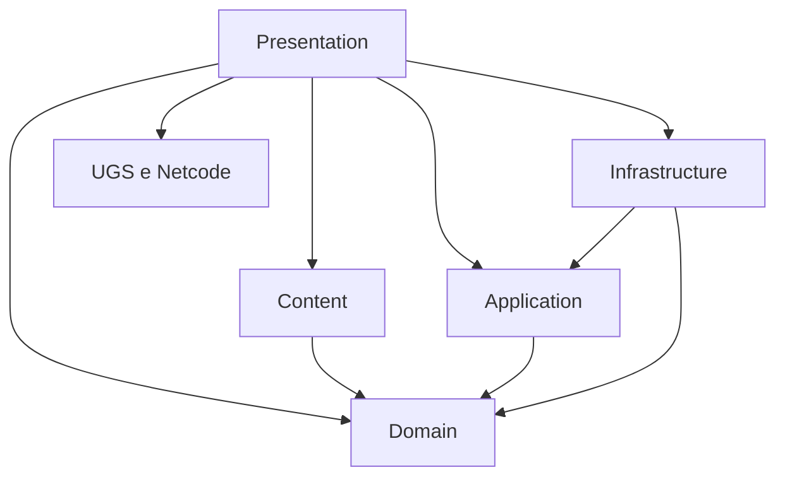
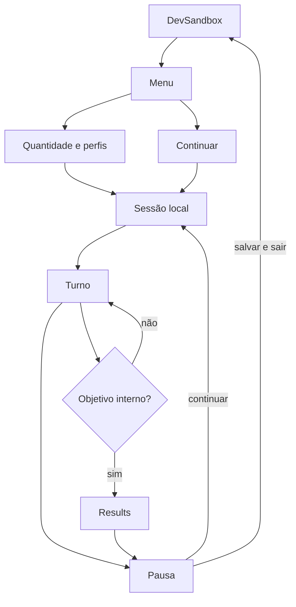
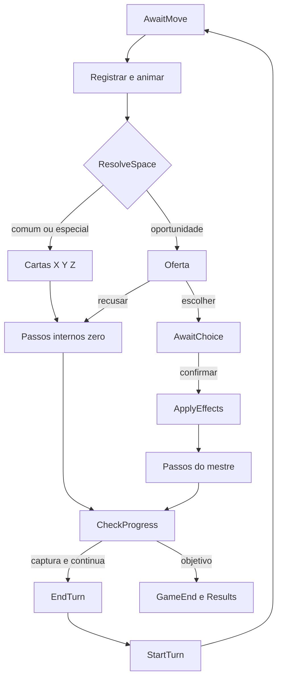
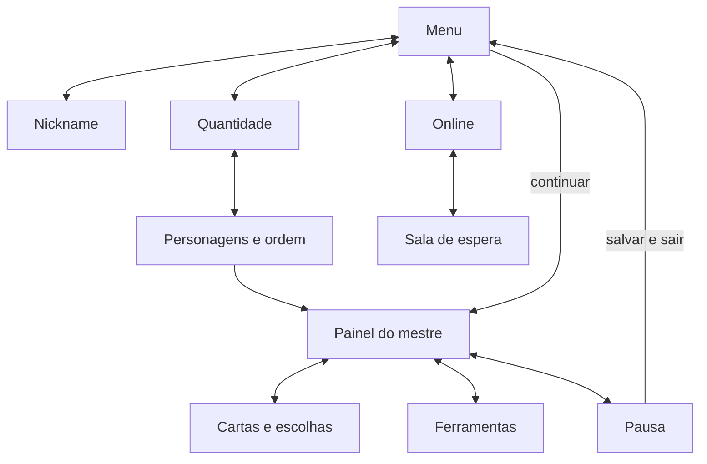
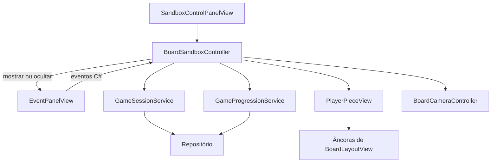
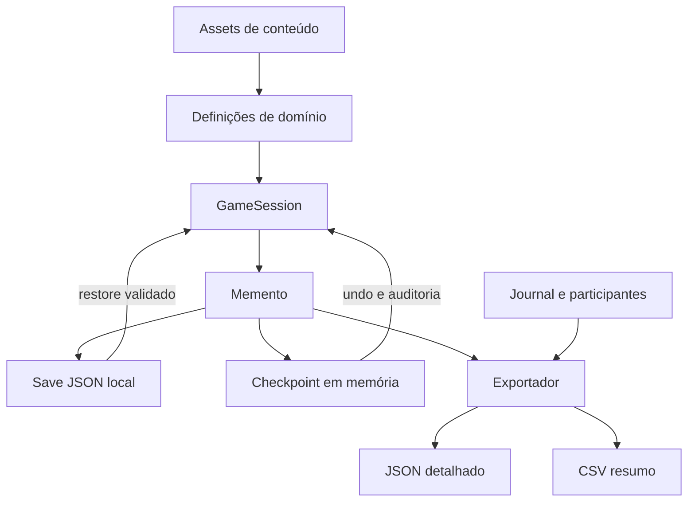

# Money Rank Unity — handoff técnico AS-IS

**Data:** 25/11/2026 · **Branch:** `feature/board-visual-event-close` · **HEAD:** `777e366052bcb2ff586fa755b85a63ad660254a3` · **Commit:** 28/10/2026, 21h52 (UTC−3).

## 1. Resumo executivo

A entrega configurada é um **console local de demonstração**, com cadastro simplificado de lugares na mesa, profissões, percurso externo, movimento manual, cartas, progressão interna, resultado lógico, undo, save e exportação. A simulação financeira ainda não participa dessa partida. A sessão criada em `BoardSandboxController.Initialize` recebe tabuleiro, trilha interna, atributos e personagens. Não recebe definições de economia, ciclo anual ou hospital. A ausência de conta do Cofre é um bloqueio anterior à conexão com o Arduino.

Das **36 posições externas**, 32 abrem cartas X/Y/Z sem efeito, incluindo as quatro extremidades. As quatro casas de oportunidade compartilham duas cartas gerais de teste. Ambas suprimem os efeitos autorados na escolha. Confirmar uma oportunidade abre a entrada manual de progressão. Assim, é possível atingir a condição lógica de vitória pelo número de passos informado pelo mestre, sem completar um atributo ou operar dinheiro. Existe um defeito concreto na tela de consulta dessas cartas e a restauração pode descartar uma escolha pendente. O fluxo completo em tela permanece sem certificação nesta revisão.

**Nível de evidência.** Os valores autorados foram lidos dos assets referenciados pela cena. As conexões de runtime foram rastreadas até os comandos e seus consumidores. Os testes executados diretamente nesta auditoria, os testes históricos da Unity e os riscos inferidos têm escopos diferentes, detalhados na seção 14. A existência de uma classe, pacote, log antigo ou campo serializável só prova sua presença.

## 2. Contexto e recorte

O mestre transcreve movimentos do tabuleiro físico. Educação financeira, fiscal e cidadania são objetivos pedagógicos. A unidade auditada é o aplicativo Unity local, inclusive o ramo online existente, os arquivos de hardware e os produtos de build presentes. O sistema web e o equipamento da feira não fazem parte deste checkout.

Foram consultados `Docs/MONEY_RANK_UNITY_SPEC.md`, `GAME_RULES.md`, `OPEN_DECISIONS.md` e `ARCHITECTURE.md`. A especificação cita perímetro de 28 e início com 2–4 pessoas. A arquitetura descreve fases anteriores, inclusive autoload e repetição de perfis. Para reproduzir esta versão, usar os dados da cena e as condições de entrada descritas abaixo. Nenhuma regra oficial foi decidida nesta auditoria.

**Estado local inicial.** O Git indicava acompanhamento de `origin/feature/board-visual-event-close`, sem diferença rastreada exibida nem staged changes. Os arquivos abaixo já existiam como não rastreados. Builds, caches e logs ignorados são evidência local sem garantia de correspondência com HEAD.

- `Assets/Resources/GDKEditionAutoGen.meta`, `Assets/Resources/GDKEditionAutoGen/GDKEdition.asset` e seu `.meta`.
- Em `Docs/Hardware/`: `money-rank-lcd-montagem-conceito-v1.png`, `money-rank-oled-096-montagem-conceito-v1.png`, `oled-096-conceito-v1-prompt.txt`, `oled-096-conceito-v1.md`, `video-montagem-contato.jpg`.

## 3. Ambiente tecnológico

Unity **6000.6.3f1**, revisão **45d8eee7de74**. Windows, C# no domínio, aplicação, apresentação, testes e automação do Editor. O renderizador usa URP. Cenas e assets são YAML da Unity. JSON é usado para configurações e estado, CSV para resumo. O projeto não contém sketch Arduino. `ProjectSettings.asset` declara `DefaultCompany/Money Rank Jogo`, resolução padrão 1024 × 768 e `activeInputHandler: 1`. A apresentação principal usa IMGUI, API de desenho imediato da Unity. Em Android, `Awake` solicita LandscapeLeft.

`Packages/manifest.json` declara pacotes, `packages-lock.json` contém 84 entradas resolvidas. O inventário de versões e dependências consta no apêndice. ZXing é uma DLL separada com licenças no projeto. UGS Authentication, Multiplayer Services, Netcode e transporte/Relay são dependências do lobby. O fluxo local tem inicialização própria. A presença de AI Assistant, GDK, Purchasing, Analytics e Multiplayer Center não demonstra uso financeiro, IA, compras ou coleta de métricas de educação na partida.

## 4. Arquitetura e fronteiras

| Camada | Responsabilidade observada | Limite importante |
|---|---|---|
| Domain | Agregado GameSession, máquina de fases, jogadores, estados por ID, validação, transações, políticas e históricos | Classes C# independentes de MonoBehaviour. As políticas institucionais exigem implementação e registro. |
| Application | Serviços recebem repositório e comandos; validam fase, invocam domínio, registram e salvam | LocalSessionSetupService tem contrato próprio e testes. A cena monta a sessão diretamente. |
| Content | ScriptableObjects convertem material do Inspector em definições com ToDomain() | Definições não contêm os saldos ou posições mutáveis da sessão. Tipos de asset existem em número maior que os assets criados. |
| Infrastructure | Repositório de sessões vivas, memento ↔ DTO ↔ JSON, escrita em disco, exportação | Falha de persistência pode ocorrer depois de mutação em memória. |
| Presentation | BoardSandboxController compõe serviços e views, recebe eventos C# de UI, executa corrotinas e troca câmera | Também decide descarte e pesos de oportunidades, retira efeitos e conclui turnos. Alterar apenas o Domain não modifica necessariamente o jogo entregue. |

O estado tem três níveis distintos. A fase de negócio está em GameSession. O controlador guarda preview, carta escolhida, checkpoints e flags transitórias. Menu, oferta, consulta e pausa possuem estado visual próprio. A animação representa um movimento já aceito e salvo. Carregar uma fase nem sempre reconstrói a interação visual correspondente.

## 5. Estrutura de arquivos e cena de entrada

| Caminho a partir da raiz | Conteúdo |
|---|---|
| Assets/_MoneyRank/Scripts | Domain (Characters, Events, Economy, Hospital), Application, Content, Infrastructure (Persistence, Export), Presentation (inclusive Camera) |
| Assets/_MoneyRank/Scenes/DevSandbox.unity | Única cena habilitada em ProjectSettings/EditorBuildSettings.asset |
| Assets/Scenes/SampleScene.unity e Assets/_Recovery/0.unity | Cena de exemplo e cópia de recuperação presentes, fora da lista de entrega |
| Assets/_MoneyRank/Content | 24 assets: dois tabuleiros, três atributos, seis personagens, oito cartas, quatro tabelas e um catálogo |
| Assets/Resources | Logo, dois atlas de casas, OBJ/MTL de capivara e créditos, dados de pacotes |
| Assets/_MoneyRank/Tests | Assemblies EditMode e PlayMode; relatórios anteriores em Logs |
| Assets/Editor, Assets/TutorialInfo, Assets/Settings | BuildAndroidApk, material de tutorial do template e configurações de renderização |
| Packages, ProjectSettings, Library, Temp, UserSettings | Dependências, configuração do produto, importações/cache e dados locais do Editor |
| Builds/Windows, Releases | Player Windows preexistente e APK. A proveniência do APK indica sucesso em 29/10 UTC a partir de 2ee7e95cda2494bd0997d78a9283d9746e5cee97, revisão diferente de HEAD. |
| Docs | Especificação, regras, decisões, arquitetura, esquema de conteúdo, handoff anterior, online, playtest e material físico |

**Composição serializada.** BoardRoot contém BoardLayoutView e BoardSandboxController apontando ao mesmo VerticalSliceBoard. O controlador referencia catálogo, três atributos, seis personagens, trilha interna, câmera e peça. PlayerPiece tem mesh, renderer e PlayerPieceView. Main Camera usa BoardCameraController. Há BoardBase e Directional Light. Não há arquivo .prefab sob Assets. A cena fornece a peça-base, clonada por jogador. As casas, âncoras, malha dos peões, marcas e painéis são construídos em execução. O ID textual visualPrefabId de um personagem não instancia sozinho um prefab.

## 6. Fluxos do sistema

1. **Abertura.** DevSandbox → BoardSandboxController.Start → BoardStartMenuView.Bind. Se o nickname local está vazio, solicitar um apelido de até 24 caracteres. Confirmar grava PlayerPrefs. Esse apelido identifica o dispositivo no lobby; os participantes locais continuam com nomes genéricos.
2. **Menu.** Novo jogo abre a quantidade, padrão dois. Continuar depende da existência do arquivo fixo. No mobile ambos estão desabilitados. Alterar nickname reabre o campo. Jogo online conduz a uma sala de espera separada.
3. **Setup local.** O mestre escolhe 1–4, atribui uma das seis profissões por jogador e define ordem. A interface exclui profissões já escolhidas, só libera iniciar com todas válidas e troca posições na ordem. A API StartNewGame valida quantidade, índices e permutação da ordem, mas não exige unicidade dos índices de personagem. Nenhuma escolha de dificuldade ou de saldo inicial.
4. **Início.** Initialize constrói jogadores sandbox-player-1 a 4, nomes “Sandbox Player N”, associa perfis e peças. Ordena por TurnOrder, registra setup, salva e entra em AwaitMove. Ao continuar, recria os jogadores, carrega memento e reposiciona as peças. Restore automático na abertura está desabilitado na cena.
5. **Turno.** O mestre digita passos externos. RegisterMove valida fase e muta posição/voltas, depois a peça anima e a câmera acompanha. Ao terminar, ShowLandingEvent escolhe o painel pela categoria da casa. Ações e escolhas diferem conforme a seção 7.
6. **Conclusão.** A progressão resolve movimento interno, captura e vitória. Sem vitória, EndTurn → StartTurn → AwaitMove do próximo jogador na ordem circular. Ao alcançar o objetivo, GameEnd → Results. Painel muda texto e câmera. Não foi localizado pódio, desempate ou comparação de patrimônio.
7. **Pausa e reinício.** Continuar retorna à partida; Sair e salvar tenta persistir antes de recarregar a cena. Novo jogo reutiliza o mesmo slot. Não há seletor de sessões nem botão específico de revanche no resultado. Ferramentas do mestre expõem undo e exportação.

## 7. Regras implementadas e regras sem execução

**Percurso externo.** No asset ativo startIndex = 0 e N = 36. Para passos inteiros s ≥ 0 e posição p, destino = (p+s) mod 36, voltas ganhas = piso((p+s)/36). BoardMovementCalculator.Move generaliza para início diferente de zero. O valor padrão do campo é 3. O campo aceita oito caracteres, não aplica limite de faces e admite zero. Em jogo, PlayerPieceView.Animate percorre cada passo durante 0,18 s por casa (valor da cena). O helper de dado decorativo não é chamado pelo construtor ativo. Não há rolagem obrigatória, leitura do dado físico ou entrada por índice de destino na UI.

**Distribuição.** Índices 0/9/18/27 representam Início–Novo Ano, Hospital, Banco e Assembleia–Cofre. As outras 32 posições distribuem quatro casas por categoria: despesas essenciais, despesas não essenciais, investimentos, impostos, dívidas, progresso de vida, lazer e oportunidade. A listagem por índice consta no apêndice. Passar pelo início conta volta. Cair nas extremidades abre o mesmo protótipo das casas comuns. Nenhuma internação, votação, cobrança ou operação bancária é disparada.

**Rota das 32 casas sem oportunidade.** ShowLandingEvent cria em memória prototype-space-NN v1, opções X/Y/Z públicas, requisitos e efeitos vazios. Clicar em qualquer opção ou fechar o protótipo executa CompleteLandingWithoutEvent, transita para ApplyEffects e chama ResolveDemonstrationProgress(0). A seleção de X/Y/Z não chama ConfirmOption. O log de movimento ou de turno não identifica qual dessas três escolhas foi feita.

**Rota das quatro oportunidades.** Índices 2/17/21/35 usam events-opportunity. Duas cartas v1 gerais, sandbox-opportunity-01 e -02, cada uma com opção continue. TryShowOpportunityOffer filtra por categoria, tag geral ou profissão compatível, exclui profissional já usada e sorteia até três cartas sem reposição dentro da oferta. Peso 1 para elegível nova, 0,5 para geral já usada. Com apenas duas elegíveis e três vagas, as duas entram: o peso afeta sua ordem, não a presença. Nenhuma carta profissional autorada. O descarte profissional pode ser por jogador ou por profissão compartilhada conforme flag. Uso geral é marcado nos estados de todos os jogadores após confirmação.

Consultar abre o detalhe; voltar, recusar todas ou escolher seguem rotas distintas. Fechar **a oferta** equivale a recusar. Selecionar a carta inicia AwaitChoice e salva. A tag effect:pending-approval faz HandleOpportunityChosen construir uma versão jogável com efeitos vazios; o state.set de last-event que aparece no asset não é aplicado. A confirmação registra a resolução, atualiza marcas de uso e pede passos internos ao mestre. Cancelar o preview retorna às opções. Fechar a janela em AwaitChoice tenta undo até o checkpoint de movimento. O catálogo também contém despesa, investimento e cidadania; a cena não despacha suas cartas ao cair nessas casas.

**Trilha interna e captura.** SandboxInnerBoard possui seis posições lógicas (0–5) e **um estado por jogador**. 0 e 2 são checkpoints protegidos; 5 é objetivo protegido. 1, 3, 4 permitem captura. A política linear rejeita passos negativos e usa min(posição + passos, 5). Só atualiza o checkpoint ao **terminar** nele. Pular sobre 2 não o grava. Em destino desprotegido, os adversários que ocupam a posição voltam aos respectivos checkpoints. O serviço resolve movimento → captura → vitória em cópias antes de efetivar. O primeiro movente que termina em 5 vence com código SANDBOX_INNER_GOAL_REACHED; não precisa de número exato. A UI aceita 5 passos desde a origem. Quatro peões visuais por cor e grade 15 × 15 não constituem quatro estados individuais de Ludo.

| Tema | Capacidade no código | Efeito na sessão iniciada pelo menu |
|---|---|---|
| Dinheiro inicial e salários | CharacterDefinition traz startingResources e salaryRules; EconomyDefinition admite saldos de abertura | Listas vazias nos seis perfis. Economia não fornecida. Saldo inicial e salário são **indefinidos**, não R$ 0. |
| Ciclo anual | AnnualCycleService calcula pendentes = piso(voltas/L) − processados; resolve um por vez com política e transação antes de marcar | Nenhum L nem política anual no bootstrap. A terceira volta não dispara pagamento. |
| Imposto de renda e outros | TaxCalculator aceita base não negativa, regra com taxa, isenções e arredondamento registrado. Tributo = arredondar(base × taxa); fonte debitada, cotas arredondadas, último destino recebe resto | Sem alíquota, base, isenção ou distribuição ligada ao jogo. IPTU, IPVA, IOF e IR/Fiscalização são nomes de casas. |
| Sonegação, multa, fiscalização | Não localizada rotina jogável de declaração, omissão, sorteio fiscal, cálculo ou cobrança de penalidade | Nenhuma probabilidade ou valor de multa aplicável. |
| Banco, dívidas e cofre | EconomyTransactionService exige contas válidas, lançamentos balanceados por unidade, limites e ID único. InstitutionOperationService delega política. Ajuste administrativo exige autorização e motivo | Sem contas configuradas, juros, parcelas, voto, crédito, subsídio ou saldo do Cofre. Não existe painel financeiro operacional. |
| Hospital | HospitalService admite estado de internação, movimentos perdidos e resolução por política | Admit rejeita internação duplicada, motivo vazio e número negativo de movimentos perdidos; TryConsumeMovementSkip consome a pendência explicitamente. A casa não interna. Não se aplica custo de saída, dado de recuperação ou gatilho de toxina/cortisol. |
| Investimento, casa e carro | EconomicResourceService oferece validação de conta, titular, limite e política | Sem preço, rendimento, aquisição, imposto de propriedade ou checkpoint adquirido. Reserva de Emergência é nome de casa. |
| Carreira e habilidades | CharacterRuleDefinition e campos do perfil permitem definir efeitos e progressão | Sem promoções, bônus, modificadores, desvantagens ou salário diferenciado ativos. |
| Dificuldade e desempate | Não foi encontrado seletor, parâmetro de sessão ou política ativa para Fácil/Médio/Difícil ou desempate | Uma configuração de sandbox; vitória só avalia o movente. |

## 8. Personagens e atributos

| Perfil visível | ID salvo | Asset |
|---|---|---|
| Professora | sandbox-character-a | SandboxCharacterA |
| Médica | sandbox-character-b | SandboxCharacterB |
| Economista | capivara-economista | SandboxCharacterEconomist |
| Atleta | capivara-atleta | SandboxCharacterAthlete |
| Empreendedora | capivara-empreendedora | SandboxCharacterEntrepreneur |
| Motorista de Aplicativo | capivara-motorista-app | SandboxCharacterDriver |

Os seis arquivos têm salaryRules, startingResources, startingAttributes, passiveAbilities e disadvantages vazios e progressionTrackId = sandbox-inner-board. O ID da professora e o da médica merecem atenção numa futura migração de saves. O vínculo profissão–oportunidade existe por tags, porém as duas cartas disponíveis são gerais. A peça usa o modelo compartilhado Models/Capybara/capybara e deslocamentos para separar jogadores na mesma casa. As quatro cores de peça no controlador são iguais (RGB 0,62).

| Atributo solicitado | Inicial e limites | Ganhos, perdas, gatilhos e consequências | Responsável verificável |
|---|---|---|---|
| Reserva | Sem estado com esse ID; mínimo/máximo indefinidos | A casa Reserva de Emergência abre X/Y/Z; não constitui reserva monetária nem proteção contra captura | VerticalSliceBoard, ShowLandingEvent |
| Cidadania | Sem estado; sem limites | Cartas e tabela de cidadania no catálogo não incrementam marcador no fluxo ativo | SandboxCitizenshipTable, ShowLandingEvent |
| Conhecimento | Sem estado; sem limites | Curso Gratuito é oportunidade; a oferta não credita conhecimento | TryShowOpportunityOffer, HandleOpportunityChosen |
| Toxina | Sem estado; sem limites | Sem acréscimo, redução, internação ou regressão por toxina | Initialize; lista attributeDefinitionAssets da cena |
| Cortisol | Sem estado; sem limites | Nenhum débito por estresse, recuperação ou efeito sobre passos | Initialize; mesma lista da cena |
| Dívidas | Sem estado desse atributo; sem saldo de dívida inicial configurado | Casas de dívida chamam protótipo; sem juros, penalidade de movimento ou compensação com reserva | VerticalSliceBoard, ShowLandingEvent; Economy ausente na sessão |

**Únicos marcadores ativos:** sandbox-attribute-a, -b, -c. Tipo sandbox, threshold 3, handler sandbox-carry, completionEffects vazio. GameSession.AddPlayer cria AttributeState independente em zero progresso e zero ciclos. CarryAttributeOverflowHandler.Calculate usa total = progresso + delta; total negativo é rejeitado, progresso = total mod 3, ciclos adicionais = piso(total/3). O resultado vigente é 0–2 e os ciclos acumulados são separados. Um delta negativo válido reduz o progresso corrente; o handler não toma emprestado de ciclos já concluídos. GameProgressionService oferece aplicação por atributo em CheckProgress. A cena não expõe controle de delta, nem mapeia esses três IDs aos seis nomes acima.

EffectExecutor.Preview percorre efeitos na ordem declarada sobre uma cópia do snapshot; cada efeito enxerga o estado deixado pelo anterior. Um handler ausente ou rejeitado interrompe o preview. Não há composição paralela nem arbitragem por prioridade pedagógica. Os handlers registrados no sandbox escrevem/removem chave de EventState, e os requisitos consultam igualdade/existência. Não há prioridade definida para combinações de toxina, cortisol e dívida, compensação com atributos positivos ou movimento derivado de completar vários medidores. A ordem movimento–captura–vitória do tabuleiro interno é outra operação.

## 9. Interface e design

As telas abaixo são estados de desenho na mesma cena. O mapeamento é de código e referências. Não houve captura útil do player desta revisão; não se anexaram telas reconstruídas.

| Tela ou sobreposição | Conteúdo e comandos | Navegação, interação e limitação |
|---|---|---|
| Nickname | Campo, placeholder, teclado mobile e Confirmar | Exige texto não vazio; preferência local editável. Não identifica cada jogador físico. |
| Menu inicial | Logo, nickname, alterar nickname, Novo jogo, Continuar e Jogo online | Continuar verifica existência do arquivo, sem validar seu conteúdo. No celular só está disponível o ramo online para jogar. |
| Quantidade | Botões 1, 2, 3, 4, contagem de capivaras e peões, Pronto/Voltar | Seleção destacada; Pronto abre atribuição. Texto anuncia quatro peões internos por jogador; domínio guarda uma posição. |
| Personagem e ordem | Linha por lugar, seletores de profissão e ordem, Voltar e iniciar | Perfis já tomados saem das opções e a ordem é permutada. Sem nomes de mesa editáveis ou demonstração de habilidades. |
| Jogo online | Criar sala no PC, entrada por código, leitura/cancelamento de QR no mobile, status e voltar | Bloqueia ações durante operação; câmera pede autorização. Código digitado ou lido conduz ao lobby. |
| Sala de espera | Código e QR do anfitrião, membros, apelidos, coroa do mestre, lugares aguardando e sair | Até cinco conexões incluindo mestre. Não há comando de partida autoritativa sincronizada nem reconexão de jogo. |
| Tabuleiro e painel do mestre | Nome sintético, personagem, casa numerada a partir de 1, fase, status, campo de passos e Mover; ferramentas recolhíveis | Arrastável, rolagem, bloqueio durante animação/modal. Em ResolveSpace aparece Concluir casa quando painel livre; em ApplyEffects/CheckProgress aparece campo de passos internos (padrão 1). Sem extrato ou indicadores fiscais. |
| Cartas X/Y/Z | Categoria, nome da casa, três cartões e fechar | Uma seleção conclui imediatamente sem comparação de consequências. X também nomeia a primeira opção e o controle de fechar. |
| Oferta e consulta | Título de cada carta, Consultar, Recusar todas, texto educacional, efeitos autorados, aviso de efeito pendente, voltar ou escolher | Fechar a oferta a recusa. A consulta pode exibir state.set cuja aplicação foi suspensa. Defeito no retorno/escolha descrito na seção 13. |
| Opções, preview e confirmação | Disponibilidade por opção, detalhes, Cancelar, Confirmar, erros e fechar | Cancelar o preview preserva a escolha pendente; fechar durante AwaitChoice tenta desfazer o movimento. Reabrir evento pendente pode saltá-lo. |
| Pausa | Pausar, Continuar e Sair e salvar, mensagem de falha | No jogo local usa timeScale e inibe entrada nos painéis. Retorna ao menu recarregando a cena após persistência. |
| Resultado | Mudança de câmera e de texto no painel do mestre | Winner e motivo vivem em GameResult. O painel informa fase; sem tela dedicada de colocação, resumo pedagógico ou análise comparativa. |

**Identidade.** Menu com fundo #111111, destaque #F5C542, amarelo #FFD966, laranja #F28C28, texto #FFFFFF e #E6E6E6. Pausa acrescenta #081827 com alfa 250/255, #BE2630 e #CDD7DE. No tabuleiro, verde #009E3D, vermelho #F21820, amarelo #FFE000, azul #08A9DF, branco #FFFFFF, cinza #B8B8B8, cantos #A0A0A0. Logo MoneyRankLogo.png, arquivos MoneyRankCornerAtlas.png, MoneyRankEventAtlas.png e modelo .obj/.mtl presentes. A coroa é desenhada em textura por CreateCrownTexture. O apêndice diferencia recursos usados e arquivos apenas encontrados.

**Tipografia, escala e espaçamento.** GUIStyle deriva de GUI.skin.label/button/textField. Sem fonte de marca incorporada identificada para os painéis. Exemplos do menu: título 42 × escala, texto 16 × escala, margens internas de 24–38 × escala e separação de 14 × escala nos seletores. O painel usa título 22 e detalhe 14 × escala; base de 340 × 430, espaçamento de 10, botões 32–42. Menu referencia 1280 × 720, desktop limita a escala a 0,62–1,2 e mobile a 0,72–1,2. A pausa aplica 0,55–1,1. Há safeArea e tratamento de teclado móvel. Painel de oportunidades limita o quadro a 760 × 540, mas usa linhas e botões em pixels fixos. Em janela estreita, textos e botões podem se sobrepor. SandboxControlPanelView.EnsureStyles só inicializa uma vez, mesmo após redimensionamento. A fase visível e os controles IMGUI nativos variam em acabamento entre menu, painel, oferta e cartas. Validação em projetor, escala do Windows e dispositivo real está pendente.

## 10. Integração física

| Item | Evidência no projeto | Estado para a feira |
|---|---|---|
| Fonte do saldo | A cena não passa EconomyDefinition nem conta de tesouraria; a respectiva extremidade abre X/Y/Z | Falta inclusive definir o valor autoritativo que poderia ser transmitido |
| Unity → controlador | Busca em fontes e assemblies próprios por System.IO.Ports, SerialPort, BaudRate e Arduino; sem implementação localizada | Sem biblioteca serial de aplicação, seleção de COM, baud rate ou abertura de porta |
| Protocolo | Sem encoder, mensagem inicial, framing, frequência de envio, confirmação ou evento de atualização localizado | Não há formato vigente a preservar |
| Recuperação e consistência | Sem envio após restore/undo, reconexão, repetição de último saldo ou tratamento de placa ausente | Impossível verificar sincronismo ou latência com hardware |
| Firmware e módulo | Sem .ino em Assets; Docs/Hardware contém imagens conceituais e nota sobre OLED 0,96 I²C SSD1306 | Modelo físico instalado e firmware externo não verificados. LCD e OLED são alternativas citadas; o “100” da imagem é ilustrativo. |

O único caminho físico-digital evidenciado no jogo local é o mestre informando passos. O QR do lobby transporta código de sessão e não saldo. Não há fluxo Arduino implementado para diagramar.

## 11. Dados, persistência e valor analítico

| Entidade | Conteúdo e duração | Escrita/leitura |
|---|---|---|
| Player e GameSession | IDs fixos de lugar e sessão, nome, turnOrder, fase, jogador atual, resultado. Personagem associável por ID durante setup | Initialize, AddPlayer, AssignCharacter, Start e CompleteTurn |
| Estado por jogador | Posição/voltas externas, progresso/ciclos por atributo, posição/checkpoint interno, mapa chave–valor de evento, profissão. Hospital e ano são opcionais | PlayerStateMemento e GameSession.CreateMemento/Restore |
| Seleção e resolução | Evento ativo, versão, tabela, casa, política; registro confirmado com opção, operador, instante, estados antes/depois | BeginEventChoice, EventPreviewService, EventConfirmationService e GameEventService |
| Auditoria de ações | Tipo de ação, jogador, fase anterior/posterior, origem, operador, parâmetros e instante | SessionActionRecorder, SessionActionHistory; operador local fixo sandbox-facilitator |
| Economia | Contas por dono/tipo/unidade, saldo decimal, limites; ledger com ID, origem, operador, data, motivo, lançamentos e snapshots | EconomyTransactionService; disponível como módulo. Histórico financeiro de uma partida vanilla não comprova atividade fiscal |
| Undo | Checkpoint de memento anterior à ação. GameUndoService restaura, conserva históricos de evento/economia/ações e registra reversão | Pilha da UI e journal em memória. Registro de ação salvo; não há botão para desfazer uma ação de uma execução anterior |
| Nickname e lobby | MoneyRank.PlayerNickname em PlayerPrefs; apelido como propriedade de participante na sessão remota | BoardStartMenuView.Bind e OnlineSessionCoordinator; não é autenticação do aluno local |

**Arquivo de partida.** Um slot com SessionId dev-sandbox-session-v2. Sob Application.persistentDataPath/MoneyRank/Saves, nome session-{SHA256(id)}.json. Memento atual **7**, Restore aceita schemas **4 a 7**, com validações adicionais de jogador, fase, definições e compatibilidade. Não há promessa de importar qualquer save com um número desse intervalo. Dados de conteúdo são reconstruídos antes do restore. SaveStore escreve temporário e substitui, mantendo .bak; Load lê somente o principal. FileBackedGameSessionRepository.Save lança InvalidOperationException se a escrita falhar. Durante a retomada, ResolvePlayerCount carrega o arquivo e Attach faz outra leitura. HasSavedGame só procura o caminho físico.

**Exportação.** FilePlaytestExporter gera playtest-{hash}.json e .csv em persistentDataPath/MoneyRank/Exports. JSON de exportação v1 inclui participantes, ordem, profissão, tempos, registros de undo e memento. CSV UTF-8 com **uma linha por exportação** e 11 colunas: sessionId, phase, playerCount, actionCount, eventResolutionCount, economyTransactionCount, processedAnnualCycles, hospitalizedPlayerCount, undoCount, durationSeconds, exportedAt. Cada arquivo é substituído individualmente com backup. Uma falha entre as substituições pode deixar o par de gerações diferentes.

**Interpretação para pesquisa.** Não tratar contagem de resoluções como contagem de todas as casas visitadas: X/Y/Z encerram sem resolução de carta no histórico de eventos. Undo preserva a ação revertida. Reconstituir a trajetória considerando action.undone. O mesmo ID é reutilizado em mesas sucessivas e a exportação repete o nome físico. A duração usa início da inicialização atual e, para partida encerrada, horário da chamada de exportação; pode encurtar após retomar ou aumentar se exportar depois da vitória. O CSV não mede aprendizagem, resposta individual aos três protótipos, tributos pagos ou percepção dos estudantes.

## 12. Matriz de implementação

O status se refere ao comportamento descrito na linha. “Implementado e testado” limita-se aos cenários executados; “implementado, mas não testado” designa o caminho integrado nesta revisão. “Apenas interface” inclui casas cuja única ação é a carta neutra.

| Funcionalidade | Comportamento atual | Status | Arquivo/classe/método | Problema identificado | Dependências |
|---|---|---|---|---|---|
| Máquina de fases | Valida transições e rejeita saltos | Implementado e testado | GameFlowStateMachine.CanTransition | Teste não cobre falha de disco entre fases | GamePhase |
| Cadastro local em cena | Seleciona 1–4 lugares, gera nomes fixos | Parcialmente implementado | BoardStartMenuView.DrawSetupScreen, BoardSandboxController.Initialize | Identificação por mesa limitada | Cena e preferências |
| Caso de uso alternativo de setup | Valida 2–4, nomes, ordem e perfil | Implementado e testado | LocalSessionSetupService; testes homônimos | Cena não usa esse caso de uso | Repositório |
| Personagem e ordem | Seis perfis, UI exige exclusividade e permite trocar ordem | Implementado, mas não testado | DrawCharacterSelectionScreen, StartNewGame | API de entrada aceita repetição | Seis assets |
| Habilidades, salários e progressão de carreira | Apenas campos vazios e nomes | Não implementado | CharacterDefinition, SandboxCharacter*.asset | Nenhuma política profissional em jogo | Regras aprovadas |
| Modos de dificuldade | Nenhum seletor, modelo ativo ou balanceamento por modo | Não implementado | DrawSetupScreen, Initialize | Sem diferenças entre fácil/médio/difícil | Decisão de produto |
| Cálculo de movimento e voltas | Módulo do percurso, volta completa, rejeição de negativo | Implementado e testado | BoardMovementCalculator.Move | UI aceita números incompatíveis com dado físico | BoardDefinition |
| Animação e câmera | Peça por jogador, coroutine, foco na chegada | Implementado, mas não testado | PlayerPieceView.Animate, BoardCameraController.SetState | Duração proporcional sem teto operacional | Âncoras e tempo |
| Casas comuns e extremidades | X/Y/Z, fechar ou escolher conclui com zero passos internos | Apenas interface | ShowLandingEvent, HandleOptionRequested | Sem efeitos ou registro de X/Y/Z | VerticalSliceBoard |
| Motor de eventos | Pré-condição, preview, confirmação e histórico | Implementado e testado | EventPreviewService, EventConfirmationService | Só dois handlers de efeito registrados na cena | EventState |
| Oferta/consulta de oportunidade | Duas cartas gerais pendentes com consulta e escolha | Com defeito | EventPanelView.DrawOpportunityPanel | Acesso nulo após voltar/escolher | Estado visual e callbacks |
| Atributos genéricos | Carry, validações e cálculo de ciclos | Implementado e testado | CarryAttributeOverflowHandler.Calculate | Sem efeito de conclusão nos assets | SandboxAttributeA/B/C |
| Seis atributos do produto | Sem definições com os nomes solicitados | Não implementado | Initialize, GameSession.AddPlayer | Sem gatilhos ou prioridades | Modelo definitivo |
| Movimento interno, captura e vitória lógicos | Estado único por jogador, checkpoint e objetivo | Implementado e testado | BuiltInProgressionPolicies, GameProgressionService.ResolveInnerBoard | Passos finais vêm do operador | SandboxInnerBoard |
| Resultados apresentados | Fase/câmera/status | Parcialmente implementado | ResolveDemonstrationProgress, SandboxControlPanelView.DrawWindow | Sem pódio ou critério de desempate | GameResult |
| Ano, hospital e operações bancárias | Serviços isolados com políticas; sem composição na partida | Parcialmente implementado | GameAnnualCycleService, GameHospitalService, GameInstitutionOperationService | Sem parâmetros e comandos do mestre | Definições e políticas |
| Contabilidade e ajustes | Valida contas e transações; ajuste administrativo autorizado em testes | Parcialmente implementado | EconomyTransactionService, AdministrativeEconomyAdjustmentService | Nenhum saldo real na cena | EconomyDefinition |
| IR e distribuição de impostos | Calculadora genérica por política | Parcialmente implementado | TaxCalculator.Calculate | Sem regra em cena; a calculadora não avalia sozinha a lista Exemptions | Arredondamento, contas, base |
| Sonegação e fiscalização | Nome de casa | Apenas interface | VerticalSliceBoard, ShowLandingEvent | Sem declaração, risco, multa ou cobrança | Modelo fiscal |
| Investimentos e dívida jogáveis | Recursos e operações genéricos, cartas neutras | Parcialmente implementado | EconomicResourceService, ShowLandingEvent | Sem compra, juros, amortização ou rendimento | Ledger e políticas |
| Cofre público | Extremidade e extensibilidade institucional | Apenas interface | assembleia-cofre-publico, Initialize | Sem conta, saldo ou operação efetiva | Economia |
| Persistência da partida | Memento versionado, autosave, continuação | Com defeito | ResolvePlayerCount, ResumeOrOpenEvent, Restore | Perda de ordem/decisão pendente em retomada | Arquivo local |
| Undo de domínio | Restaura memento, preserva auditoria | Implementado e testado | GameUndoService, GameUndoServiceTests | Pilha disponível só na execução corrente | Journal e repositório |
| Exportação pelo painel | JSON detalhado e CSV de resumo | Implementado, mas não testado | BoardSandboxController.ExportPlaytest, FilePlaytestExporter.Export | ID fixo e duração ambígua entre execuções | Permissão de escrita |
| Lobby e QR | Criar/entrar, QR, lista, sair | Implementado, mas não testado | OnlineSessionCoordinator.CreateRoom/JoinRoom/StartQrScan | Serviço e dispositivos não verificados ao vivo | Internet, UGS, câmera, ZXing |
| Partida online | Fluxo para no lobby | Não implementado | DrawWaitingRoom, OnlineSessionCoordinator | Sem comando de início e replicação de jogo | Autoridade e protocolo |
| Unity → Arduino → display | Sem transporte ou firmware no checkout | Não implementado | Docs/Hardware, Initialize | Sem fonte do saldo e protocolo | Conta do cofre e módulo físico |
| Legibilidade em estande e estabilidade da build atual | Sem sessão renderizada desta revisão | Não verificável | DevSandbox, Logs, Releases | Teste gráfico e de dispositivo pendente | Editor/player executável |

## 13. Bugs, divergências e limites de qualidade

| ID | Condição reproduzível ou observável | Consequência e força da evidência |
|---|---|---|
| B01 | Em oportunidade → Consultar → Voltar às cartas **ou** Escolher esta carta. DrawOpportunityPanel atribui null a _opportunityPreview e, na mesma chamada, avalia _opportunityPreview.Tags.Contains(...) | Dereferência nula demonstrável pelo fluxo de código. A callback de escolha pode ter alterado a fase antes da exceção. O impacto visual após o frame não foi medido. |
| B02 | Carregar ou reabrir uma sessão em AwaitChoice. ResumeOrOpenEvent chama SkipActiveEventChoice e CompleteDemonstrationTurn | A escolha é descartada e o turno pode avançar. ReopenPendingEvent retorna a visibilidade depois desse desvio. Undo que restaura essa fase também chama o mesmo caminho. |
| B03 | Configurar três jogadores com ordem personalizada, salvar, voltar ao menu e continuar. ResolvePlayerCount lê somente quantidade; Initialize recompõe ordem 0…N−1. Restore recupera o jogador atual por ID, sem reordenar a lista | Exemplo: ordem B,A,C; salvar na vez de B; na sessão reconstruída A,B,C a vez após B pode ser C. O histórico de setup registra a ordem, mas o bootstrap não a reaplica. Reproduzido no domínio atual com memento em EndTurn; ver seção 14. A passagem pelos botões de save/load não foi executada nesta auditoria. |
| B04 | Falha de Attach por arquivo incompatível/corrompido após Initialize ter atribuído Session e criado peças; StartSelectedGame captura a exceção, OnGUI do menu retorna quando Session já existe | Risco de ficar sem caminho de recuperação pela UI. Arquivo principal existente habilita Continuar mesmo inválido. Backup não é tentado por Load. Depende do tipo/ponto da falha. |
| B05 | Informar 10.000 passos no movimento externo. SubmitMove aceita e Animate itera uma vez por passo | Aproximadamente 30 minutos de animação a 0,18 s/casa, desconsiderando overhead e pausa. O estado já mudou; o painel bloqueia novo movimento enquanto anima. Estimativa calculada, sem benchmark. |
| B06 | Campo de progressão aceita 5 desde a origem; tabuleiro físico anuncia quatro peões por jogador | Vitória por entrada manual de um único marcador. Pode ser um atalho intencional do mestre. Incompatível com inferir que uma progressão por atributos foi verificada. |
| B07 | Nova sessão usa o mesmo ID e exporta para o mesmo nome. Horário inicial e undo journal são recriados em Initialize | Sessões e exportações sucessivas podem substituir dados anteriores; duração e quantidade de undos no resumo não são longitudinais confiáveis após restauração. |
| B08 | Serviços salvam fases intermediárias. UI de retomada trata especificamente Results, AwaitChoice e ResolveSpace | Interrupção entre dois saves (por exemplo após CompleteTurn e antes de BeginTurn) pode deixar StartTurn sem comando visível para avançar. Hipótese de falha a validar injetando interrupção. |
| B09 | Campos de estado de oportunidade são atualizados após confirmação por nova escrita. Repositório lança exceção em erro de disco; exportação substitui JSON antes de CSV | Não há transação única para confirmação + marcas + par de arquivos. Falha parcial pode deixar auditoria e artefatos divergentes. Não se induziu falha no disco real. |
| B10 | Testes de apresentação ainda esperam 20 casas, âncora com “start” e rota genérica continue | A suíte histórica após sincronização diverge da cena atual. Corrigir a especificação de teste exige confirmar quais comportamentos de produto devem prevalecer. |

**Acoplamento, código sem consumidor e desempenho.** BoardSandboxController (1.260 linhas) controla inicialização, entrada, UI, políticas, seleção aleatória, validação, save, exportação e retomada. BoardStartMenuView (1.119) reúne fluxo local, nickname, QR, sala e desenho imediato. Existe duplicação de setup entre controlador e LocalSessionSetupService; a diferença observável de mínimo de jogadores é uma consequência. Helpers de painel/estilos de botão são repetidos em menu e pausa. GameEventSelectionService é construído pelo controlador, mas a seleção de oportunidade usa código próprio e as demais casas constroem evento sintético. Em BoardLayoutView, CreateDecorativeDie, CreateCornerIcon e CreateAtlasQuad aparecem como definições sem chamada no caminho Rebuild. O dado e os atlas não devem ser apresentados como elementos visuais ativos por sua mera presença.

A geometria 3D é gerada de novo em Rebuild; SetActivePlayerCount pode disparar outra construção depois de Awake. Há cache de materiais e malha de peões, mas a peça clona materiais por renderer. O OBJ local tem 15.216 registros de vértices e 5.072 faces. Parte da UI cria estilos e coleções durante OnGUI; CharacterDefinitions reconverte perfis em lista a cada consulta. Undo retém mementos em memória e os saves/exportações carregam históricos crescentes. São custos estruturais, sem perfil de CPU, GPU, memória ou FPS medido. O teste de GUIDs da seção 14 não detectou referência de asset ausente na cena ativa e nos 24 assets de conteúdo; isso não valida todo identificador lógico.

## 14. Testes, comandos e limites de execução

**Compilação atual:** os sete assemblies MoneyRank recompilaram com saída 0: Domain, Application, Content, Infrastructure, Presentation, Domain.EditModeTests e PlayModeTests. Usou-se Roslyn do SDK .NET 10.0.401 com os response files existentes do Bee para o Editor. Para cada `MoneyRank.<nome>.rsp`, foram redirecionados `-out`, `-refout` e referências MoneyRank para diretório temporário e executado `dotnet csc.dll @<rsp-temporário>`. Isso testa compilação gerenciada dos fontes do checkout com dependências locais existentes. Não constrói um player nem valida importação, serialização de runtime, interface ou dispositivo.

**Casos executados agora:** 100 aprovados, 0 falhas, em 18 fixtures dos fontes atuais. Foi compilado um executável temporário com Domain + Application, NUnit já presente e as fixtures EditMode sem referências a UnityEngine, UnityEditor ou às camadas Content, Infrastructure e Presentation. Execução por reflexão de cada [Test] e de cada combinação [TestCase], usando `MonoBleedingEdge/bin/mono.exe Run.exe` e as asserções reais do projeto. Não equivale a uma corrida do Unity Test Runner; não inclui cenas, JsonUtility, dispositivos nem medição percentual de linhas/branches.

| Fixture (sufixo Tests omitido) | Casos aprovados | Fixture | Casos aprovados |
|---|---:|---|---:|
| AdministrativeAdjustment | 3 | BoardMovement | 6 |
| BuiltInEventHandler | 4 | BuiltInProgressionPolicy | 5 |
| EventConfirmation | 6 | EventDefinition | 7 |
| EventPreview | 7 | EventSelection | 4 |
| GameEconomyModuleService | 3 | GameEventService | 3 |
| GameFlowStateMachine | 14 | GameProgressionService | 3 |
| GameSessionMemento | 3 | GameSessionService | 5 |
| GameSession | 15 | GameUndoService | 2 |
| InnerBoardResolution | 4 | LocalSessionSetupService | 6 |

**Editor nesta auditoria.** Copiar Assets, Packages e ProjectSettings para diretório temporário isolou a execução da árvore original. Com o Editor 6000.6.3f1 foi tentado `Unity.exe -batchmode -nographics -projectPath <cópia> -runTests -testPlatform <EditMode|PlayMode> -testResults <resultado.xml> -logFile <log>`. Nenhum XML foi produzido. O log da tentativa EditMode terminou com crash handler; o processo foi limitado a 90 s. Em PlayMode também houve crash handler, erro de inicialização do Unity Licensing Client e conexão IPC recusada. Uma tentativa intermediária de staging em C:/workspace foi recusada pelo filesystem e não conta como execução da suíte. Nenhuma instalação ou troca de configuração foi feita. Sem player gráfico atual validado, não foi possível capturar screenshots representativas. A falha de inicialização neste ambiente não prova crash da partida no notebook do evento.

**Reprodução dirigida adicional (B03).** Em executável temporário compilado pelo mesmo Roslyn, foram criadas duas GameSession com os mesmos IDs A/B/C. A primeira usou turnOrder 1/0/2 e chegou a EndTurn de B. A segunda foi reconstruída como o bootstrap de continuação, com turnOrder 0/1/2, e recebeu Restore da primeira. Resultado literal: `current:B`, `uninterrupted:A restored:C` após CompleteTurn nas duas instâncias. Isso isola a mudança na sequência e dispensa inferir a falha pelo log antigo. O transporte JSON não participou deste ensaio.

**Outras verificações locais.** Comandos de leitura: `git status --short --branch`, `git status --porcelain -uall`, `git rev-parse HEAD`, `git log -1 --format=%ci`, `Get-ChildItem -Recurse`, `Get-Content`, `Select-String`. A busca por rg não estava disponível; a inspeção prosseguiu em PowerShell. Cruzamento de 39 GUIDs distintos da cena e dos 24 assets com .meta: 35 do próprio Assets, dois recursos embutidos da Unity e dois da URP (Lit.mat e UniversalAdditionalLightData.cs). A ligação por **ID textual** é diferente: das oito tabelas mencionadas pelas casas, só events-investment e events-opportunity existem no catálogo. Faltam events-essential-expense, events-non-essential-expense, events-tax, events-debt, events-life-progress e events-leisure; events-expense e events-citizenship não têm referência por ID no percurso. O fallback X/Y/Z mascara a lacuna.

**Resultados históricos encontrados** (datas pelos arquivos locais; revisão exata dos XML não identificada):

| Arquivo em Logs | Data | Total | Passaram | Falharam |
|---|---|---:|---:|---:|
| EditModeResults.xml | 03/10/2026 | 62 | 62 | 0 |
| editmode-results.xml | 07/10/2026 | 187 | 187 | 0 |
| playmode-results.xml | 07/10/2026 | 1 | 1 | 0 |
| editmode-after-sync.xml | 21/10/2026 | 187 | 180 | 7 |
| playmode-after-sync.xml | 21/10/2026 | 1 | 0 | 1 |

| Caso histórico com falha | Observação registrada |
|---|---|
| LayoutBuildsOneAnchorPerConfiguredSpace | Esperava “start” no nome; recebeu Anchor 00 |
| TemporaryAssetConvertsToDomainDefinition | Esperava 20 posições; obteve 36 |
| MasterPanelUndoesProgressionWithoutErasingAuditAndExportsPlaytest | Opção continue não exibida |
| SceneAutosaveRestoresActiveEventChoiceAndPanel | SESSION_SAVE_NOT_FOUND ao tentar ler quantidade |
| SceneAutosaveRestoresThePreviousSandboxSession | Mesmo erro antes da restauração |
| SceneShowsAndRestoresPersistedWinnerResult | Mesmo erro antes de verificar o vencedor |
| SceneRunsTwoPlayerTurnCycleThroughSessionService | Esperava AwaitChoice; obteve ResolveSpace |
| AnimatedMoveOpensEventAndConfirmedProgressionChangesTurn (PlayMode) | Asserção esperava valor não nulo; recebeu null |

Os três erros de arquivo em testes históricos não demonstram perda de todo save existente: o caminho de teste tenta restaurar antes de haver arquivo no cenário. Estão presentes 36 arquivos de fixtures EditMode e um PlayMode. Os fontes EditMode contêm 187 marcações [Test]/[TestCase]. Nenhuma evidência desta execução autoriza dizer “187 testes verdes”, “build atual homologada”, “online validado” ou “Arduino funcionando”.

## 15. Diagramas do sistema atual

### Arquitetura e dependências

### Fluxo de partida

### Ciclo de um turno

### Navegação entre telas

### Componentes no caminho de interação

### Fluxo de dados da sessão

## 16. Pendências técnicas priorizadas

Complexidade relativa **P** = mudança localizada, **M** = mais de uma camada ou cenário persistido, **G** = regras, dados, implementação e validação de ponta a ponta. Prioridade considera uma demonstração local em Windows. “P0” também identifica bloqueio de um fluxo crítico da apresentação; não significa que o menu inteiro não abra.

| Prioridade | Tarefa para a próxima etapa | Complexidade | Dependência e critério de saída |
|---|---|---|---|
| P0 | B01, tornar segura a consulta de oportunidade | P | Exercitar ambos os botões no player sem exceção, preservando escolha/retorno |
| P0 | Homologar um percurso completo no executável da revisão a apresentar | M | Editor licenciado e teste em cópia isolada. Exercitar início, cada tipo de carta, próximo jogador, save/continue, vitória, exportação e volta ao menu; identificar hash da build |
| P1 | B02–B04/B08, tornar retomada fiel, com falha recuperável | M | Definir semântica de fechar, restaurar escolha, ordem e fases intermediárias; manter compatibilidade de save |
| P1 | Conectar economia, atributos e efeitos aprovados ao turno | G | Produto aprova contas, valores e sequência; validar antes/depois e transações no histórico e no painel |
| P1 | Conciliar percurso físico, trilha interna, quantidade de peões e condição de fim | G | Confirmar correspondência casa–índice e regras de captura/checkpoint/vitória; teste com kit real |
| P1 | Substituir tabelas ausentes e placeholders previstos para a feira | M–G | Conteúdo aprovado e efeitos suportados; rastrear cada escolha à versão da carta |
| P1 | B05, limitar ou abreviar entrada/animação desproporcional | P–M | Definir se mestre aceita exceções ao dado; testar 0, limite, inválido e correção de erro |
| P1 condicional | Enviar saldo ao display, se indispensável à demonstração | M após economia | Conta autoritativa, módulo identificado, firmware e contrato aprovados. Verificar abertura, atualização, undo, retomada e reconexão física |
| P2 | B07/B09, distinguir sessões e conservar exportações/tempos | M | Definir unidade de pesquisa e política de retenção. Simular falha entre arquivos e retomada |
| P2 | Identidade dos jogadores, distinção visual, resultado legível e escala de janela | M | Testar nomes, cores e botões no projetor e em 1024 × 768; evitar depender só da cor |
| P2 | Reduzir responsabilidades duplicadas e alinhar testes com regras aprovadas | M | Fazer depois de congelar os contratos; conservar o conjunto de casos de domínio |
| P3 | Avaliar pacotes sem consumidor observado, helpers visuais e custo de rebuild | P–M | Medir tamanho, importação e frame time antes de retirar dependências |
| P3 | Partida online sincronizada ou novos recursos de rede | G | Lobby já existe; escopo da feira e autoridade de sessão precisam de decisão |

## 17. Recomendações para a próxima etapa

1. **Congelar o contrato da demonstração com o tabuleiro em mãos.** Fixar mapa da peça física para os índices da Unity, quantidade de peões lógicos e quais decisões o mestre deve registrar. Conferir a trilha com 36 posições antes de editar motor ou arte.
2. **Transformar as regras definitivas em exemplos verificáveis.** Registrar, para cada casa, estado anterior, ação, saldo/atributos/posição posteriores e efeito esperado no histórico. Cobrir simultaneidade, insuficiência de recursos, reversão e reconexão do display, quando aplicável.
3. **Separar bloqueios de UI de decisões pedagógicas.** O acesso nulo e a perda de ordem têm causa técnica identificável. Valores de imposto, hospital e progressão dependem do responsável pelo produto. Os módulos existentes permitem reaproveitamento, mas precisam estar ligados à sessão real para contar como entrega.
4. **Validar o percurso pela entrada normal.** Exemplo mínimo de ensaio: três lugares, ordem personalizada B→A→C, movimento de 1 desde Início para X/Y/Z; outro jogador move 2 para Curso Gratuito, consulta, volta, escolhe e confirma; salvar em AwaitChoice e retomar; alcançar índice interno 5 e exportar. Comparar tabuleiro, painel, save e históricos. A aprovação depende também do teste de operação com o mestre, no equipamento da feira.

## 18. Perguntas ao responsável pelo produto

1. Qual arte física é a referência final, e qual casa física corresponde a cada índice da seção 19? Uma pessoa sozinha é modo de apresentação ou partida válida?
2. Quantos peões internos cada jogador controla, como sai da base, o que avança ou recua, e vale checkpoint ao passar ou só ao parar? Captura pode atingir vários oponentes? É preciso número exato para vencer?
3. Quais são as definições finais de Reserva, Cidadania, Conhecimento, Toxina, Cortisol e Dívidas? Qual é recurso monetário e qual é marcador? Quais limiares, ordem de resolução simultânea e efeitos após completar um ciclo?
4. Quais valores de caixa, salários, habilidades e desvantagens se aplicam às seis profissões? Personagens podem repetir? Quem escolhe ou sorteia?
5. Em que volta fecha o ano e em qual ordem incidem salário, rendimento, dívida, imposto e fiscalização? Quais bases, taxas, arredondamentos, isenções, sonegação e destino de multa?
6. Como se financiam banco e cofre, que operações podem zerar ou negativar contas, quem autoriza uso coletivo, como funciona internação e qual é o custo de saída?
7. Quais diferenças observáveis distinguem Fácil/Médio/Difícil? Há limite de tempo, fim por rodada, empate ou pódio? Quais são exigidos na Ciência Jovem?
8. Fechar carta deve cancelar o movimento, recusar a oferta, adiar a decisão ou concluir o turno? Qual comportamento ao reabrir a partida, inclusive após undo?
9. Que dados por oficina devem sobreviver entre mesas? É necessário associar aluno, apelido pseudônimo ou apenas lugar na mesa? O que conta como escolha analisável?
10. Qual placa e display serão usados no estande? Quando a conexão cair, o mestre pode prosseguir? Qual unidade/formatação deve aparecer após iniciar, desfazer ou carregar?

## 19. Inventário e referências de implementação

Todos os caminhos abaixo são relativos à raiz. Quando a coluna de uma seção usa só o tipo, o índice de fontes abaixo localiza o arquivo correspondente. A lista de métodos serve para seguir o comportamento mesmo sem abrir o repositório.

### Mapa completo do tabuleiro ativo

Fonte: Assets/_MoneyRank/Content/VerticalSliceBoard.asset. O mestre vê a casa numerada como índice + 1.

| Índice | ID estável | Categoria | Tabela solicitada | Resolução em cena |
|---:|---|---|---|---|
| 0 | inicio-novo-ano | special-space | — | Protótipo X/Y/Z |
| 1 | compra-por-impulso | non-essential-expense | events-non-essential-expense | Protótipo X/Y/Z |
| 2 | curso-gratuito | opportunity | events-opportunity | Oferta A/B |
| 3 | alimentacao | essential-expense | events-essential-expense | Protótipo X/Y/Z |
| 4 | reserva-de-emergencia | investment | events-investment | Protótipo X/Y/Z |
| 5 | descanso-em-casa | leisure | events-leisure | Protótipo X/Y/Z |
| 6 | iptu | tax | events-tax | Protótipo X/Y/Z |
| 7 | qualificacao | life-progress | events-life-progress | Protótipo X/Y/Z |
| 8 | cartao-de-credito | debt | events-debt | Protótipo X/Y/Z |
| 9 | hospital | special-space | — | Protótipo X/Y/Z |
| 10 | ipva | tax | events-tax | Protótipo X/Y/Z |
| 11 | atividade-fisica-e-parque | leisure | events-leisure | Protótipo X/Y/Z |
| 12 | emprestimo-caro | debt | events-debt | Protótipo X/Y/Z |
| 13 | carro | investment | events-investment | Protótipo X/Y/Z |
| 14 | moradia | essential-expense | events-essential-expense | Protótipo X/Y/Z |
| 15 | marco-de-carreira | life-progress | events-life-progress | Protótipo X/Y/Z |
| 16 | assinaturas-e-aplicativos | non-essential-expense | events-non-essential-expense | Protótipo X/Y/Z |
| 17 | trabalho-extra | opportunity | events-opportunity | Oferta A/B |
| 18 | banco-e-credito | special-space | — | Protótipo X/Y/Z |
| 19 | casa | investment | events-investment | Protótipo X/Y/Z |
| 20 | energia-e-agua | essential-expense | events-essential-expense | Protótipo X/Y/Z |
| 21 | parceria-novo-cliente | opportunity | events-opportunity | Oferta A/B |
| 22 | tecnologia-e-upgrade | non-essential-expense | events-non-essential-expense | Protótipo X/Y/Z |
| 23 | projeto-pessoal | life-progress | events-life-progress | Protótipo X/Y/Z |
| 24 | iof | tax | events-tax | Protótipo X/Y/Z |
| 25 | cultura-e-passeio | leisure | events-leisure | Protótipo X/Y/Z |
| 26 | conta-atrasada | debt | events-debt | Protótipo X/Y/Z |
| 27 | assembleia-cofre-publico | special-space | — | Protótipo X/Y/Z |
| 28 | contribuicao-comunitaria | life-progress | events-life-progress | Protótipo X/Y/Z |
| 29 | renegociacao | debt | events-debt | Protótipo X/Y/Z |
| 30 | ferias-planejadas | leisure | events-leisure | Protótipo X/Y/Z |
| 31 | imposto-de-renda-fiscalizacao | tax | events-tax | Protótipo X/Y/Z |
| 32 | lazer-premium | non-essential-expense | events-non-essential-expense | Protótipo X/Y/Z |
| 33 | aplicacao-financeira | investment | events-investment | Protótipo X/Y/Z |
| 34 | transporte-e-saude-basica | essential-expense | events-essential-expense | Protótipo X/Y/Z |
| 35 | bolsa-programa-publico | opportunity | events-opportunity | Oferta A/B |

### Catálogo de eventos autorados

As oito definições têm versão e ID próprios. A coluna final mostra operações **autoradas**; a seção 7 especifica o que chega à confirmação.

| Arquivo .asset | ID | Categoria | Opção | Operações no asset |
|---|---|---|---|---|
| SandboxCitizenship01 | sandbox-citizenship-01 | citizenship | continue | state.set |
| SandboxCitizenship02 | sandbox-citizenship-02 | citizenship | continue | state.set |
| SandboxExpense01 | sandbox-expense-01 | expense | continue | state.set |
| SandboxExpense02 | sandbox-expense-02 | expense | continue | state.set |
| SandboxInvestment01 | sandbox-investment-01 | investment | continue | state.set |
| SandboxInvestment02 | sandbox-investment-02 | investment | continue | state.set |
| SandboxOpportunity01 | sandbox-opportunity-01 | opportunity | continue | state.set |
| SandboxOpportunity02 | sandbox-opportunity-02 | opportunity | continue | state.set |

### Inventário de dependências resolvidas

Versões conforme Packages/packages-lock.json. Profundidade zero identifica entrada direta; profundidade positiva indica resolução transitiva. Nenhuma instalação foi executada.

| Pacote | Versão resolvida | Profundidade | Fonte |
|---|---|---:|---|
| com.unity.2d.sprite | 1.0.0 | 0 | builtin |
| com.unity.2d.tilemap | 1.0.0 | 0 | builtin |
| com.unity.ai.assistant | 2.20.0-pre.1 | 0 | registry |
| com.unity.ai.inference | 2.6.1 | 0 | registry |
| com.unity.ai.navigation | 2.0.14 | 0 | registry |
| com.unity.analytics | 3.8.2 | 0 | registry |
| com.unity.burst | 2.0.0 | 1 | builtin |
| com.unity.collab-proxy | 2.13.6 | 0 | registry |
| com.unity.collections | 6.6.0 | 1 | builtin |
| com.unity.dt.app-ui | 2.1.11 | 1 | registry |
| com.unity.ext.nunit | 2.1.0 | 1 | builtin |
| com.unity.graph-authoring | 1.0.0 | 2 | builtin |
| com.unity.ide.rider | 3.0.38 | 0 | registry |
| com.unity.ide.visualstudio | 2.0.26 | 0 | registry |
| com.unity.inputsystem | 1.20.0 | 0 | registry |
| com.unity.mathematics | 1.4.0 | 1 | builtin |
| com.unity.microsoft.gdk | 1.7.0 | 0 | registry |
| com.unity.microsoft.gdk.discovery | 1.3.0 | 1 | registry |
| com.unity.microsoft.gdk.tools | 1.7.0 | 0 | registry |
| com.unity.multiplayer.center | 2.0.1 | 0 | builtin |
| com.unity.netcode.gameobjects | 2.13.3 | 0 | registry |
| com.unity.nuget.mono-cecil | 1.11.6 | 1 | registry |
| com.unity.nuget.newtonsoft-json | 3.2.2 | 1 | registry |
| com.unity.pipeline | 0.8.0-exp.1 | 0 | registry |
| com.unity.profiling.core | 1.0.3 | 2 | registry |
| com.unity.purchasing | 5.4.4 | 0 | registry |
| com.unity.render-pipelines.core | 17.6.0 | 1 | builtin |
| com.unity.render-pipelines.universal | 17.6.0 | 0 | builtin |
| com.unity.render-pipelines.universal-config | 17.6.0 | 1 | builtin |
| com.unity.searcher | 4.9.5 | 2 | registry |
| com.unity.services.analytics | 6.3.0 | 1 | registry |
| com.unity.services.authentication | 3.8.0 | 1 | registry |
| com.unity.services.core | 1.18.0 | 1 | registry |
| com.unity.services.deployment | 1.7.2 | 1 | registry |
| com.unity.services.deployment.api | 1.1.3 | 2 | registry |
| com.unity.services.multiplayer | 2.4.1 | 0 | registry |
| com.unity.services.qos | 1.5.1 | 1 | registry |
| com.unity.services.wire | 1.5.1 | 1 | registry |
| com.unity.shadergraph | 17.6.0 | 1 | builtin |
| com.unity.test-framework | 1.8.0 | 0 | builtin |
| com.unity.test-framework.performance | 6.6.0 | 2 | builtin |
| com.unity.timeline | 6.6.0 | 0 | builtin |
| com.unity.transport | 6.6.0 | 1 | builtin |
| com.unity.ugui | 2.6.0 | 0 | builtin |
| com.unity.visualscripting | 1.9.12 | 0 | registry |
| com.unity.xr.legacyinputhelpers | 3.0.1 | 0 | registry |
| com.unity.modules.accessibility | 1.0.0 | 0 | builtin |
| com.unity.modules.adaptiveperformance | 1.0.0 | 0 | builtin |
| com.unity.modules.ai | 1.0.0 | 0 | builtin |
| com.unity.modules.androidjni | 1.0.0 | 0 | builtin |
| com.unity.modules.animation | 1.0.0 | 0 | builtin |
| com.unity.modules.assetbundle | 1.0.0 | 0 | builtin |
| com.unity.modules.audio | 1.0.0 | 0 | builtin |
| com.unity.modules.cloth | 1.0.0 | 0 | builtin |
| com.unity.modules.director | 1.0.0 | 0 | builtin |
| com.unity.modules.hierarchycore | 1.0.0 | 1 | builtin |
| com.unity.modules.imageconversion | 1.0.0 | 0 | builtin |
| com.unity.modules.imgui | 1.0.0 | 0 | builtin |
| com.unity.modules.jsonserialize | 1.0.0 | 0 | builtin |
| com.unity.modules.particlesystem | 1.0.0 | 0 | builtin |
| com.unity.modules.physics | 1.0.0 | 0 | builtin |
| com.unity.modules.physics2d | 1.0.0 | 0 | builtin |
| com.unity.modules.physicscore2d | 1.0.0 | 0 | builtin |
| com.unity.modules.screencapture | 1.0.0 | 0 | builtin |
| com.unity.modules.subsystems | 1.0.0 | 1 | builtin |
| com.unity.modules.terrain | 1.0.0 | 0 | builtin |
| com.unity.modules.terrainphysics | 1.0.0 | 0 | builtin |
| com.unity.modules.tetgen | 1.0.0 | 0 | builtin |
| com.unity.modules.tilemap | 1.0.0 | 0 | builtin |
| com.unity.modules.timelinefoundation | 1.0.0 | 0 | builtin |
| com.unity.modules.ui | 1.0.0 | 0 | builtin |
| com.unity.modules.uielements | 1.0.0 | 0 | builtin |
| com.unity.modules.umbra | 1.0.0 | 0 | builtin |
| com.unity.modules.unityanalytics | 1.0.0 | 0 | builtin |
| com.unity.modules.unitywebrequest | 1.0.0 | 0 | builtin |
| com.unity.modules.unitywebrequestassetbundle | 1.0.0 | 0 | builtin |
| com.unity.modules.unitywebrequestaudio | 1.0.0 | 0 | builtin |
| com.unity.modules.unitywebrequesttexture | 1.0.0 | 0 | builtin |
| com.unity.modules.unitywebrequestwww | 1.0.0 | 0 | builtin |
| com.unity.modules.vectorgraphics | 1.0.0 | 0 | builtin |
| com.unity.modules.vehicles | 1.0.0 | 0 | builtin |
| com.unity.modules.video | 1.0.0 | 0 | builtin |
| com.unity.modules.wind | 1.0.0 | 0 | builtin |
| com.unity.modules.xr | 1.0.0 | 0 | builtin |

### Índice de scripts do produto

Base: Assets/_MoneyRank/Scripts/. Métodos identificados por declaração na fonte. Para os tipos de dados sem comando separado, o construtor e as propriedades definem o contrato. Linhas se referem ao snapshot desta auditoria.

| Arquivo relativo | Classes, estruturas ou contratos | Métodos declarados, com linha |
|---|---|---|
| Application/AdministrativeEconomyAdjustmentService.cs | AdministrativeEconomyAdjustmentService | Apply L22 |
| Application/EventConfirmationRequest.cs | EventConfirmationRequest | Dados, construtor ou contrato |
| Application/EventConfirmationService.cs | EventConfirmationService | Confirm L16 |
| Application/EventPreviewService.cs | EventPreviewService | Preview L21 |
| Application/EventResolutionPreview.cs | EventResolutionPreview | Dados, construtor ou contrato |
| Application/GameAnnualCycleService.cs | GameAnnualCycleService | ResolveCurrentPlayer L20, RequireSession L62 |
| Application/GameEconomicResourceService.cs | GameEconomicResourceService | Execute L32 |
| Application/GameEventSelectionService.cs | GameEventSelectionService | SelectCurrentSpace L27, GetActiveDefinition L93, RequireSession L111 |
| Application/GameEventService.cs | GameEventService | PreviewOption L27, ConfirmOption L63, RequireSession L143 |
| Application/GameHospitalService.cs | GameHospitalService | Admit L20, TryConsumeMovementSkip L35, Resolve L47, RequireState L62 |
| Application/GameInstitutionOperationService.cs | GameInstitutionOperationService | Execute L33, ContainsPlayer L71 |
| Application/GameProgressionService.cs | GameProgressionService | ApplyAttributeProgress L33, ResolveInnerBoard L84, RequireSession L159 |
| Application/GameSessionService.cs | GameSessionService | Create L23, Create L28, Create L33, AddPlayer L69, RegisterMove L88, BeginTurn L115, CompleteTurn L129, ShowResults L144, BeginEventChoice L162, Start L191, AssignCharacter L205, RequireSession L223 |
| Application/GameUndoService.cs | GameUndoService | CreateCheckpoint L24, Undo L41, RequireSession L107 |
| Application/IAdministrationAuthorizationPolicy.cs | IAdministrationAuthorizationPolicy | Dados, construtor ou contrato |
| Application/IGameSessionRepository.cs | IGameSessionRepository | Dados, construtor ou contrato |
| Application/IGameSessionSaveStore.cs | IGameSessionSaveStore | Dados, construtor ou contrato |
| Application/InnerBoardResolutionResult.cs | InnerBoardResolutionResult | Dados, construtor ou contrato |
| Application/LocalSessionSetupService.cs | SessionSetupParticipant, LocalSessionSetupRequest, LocalSessionSetupService | CreateAndStart L108, Failure L154, RequireSuccess L157 |
| Application/ManualEconomyAdjustmentRequest.cs | ManualEconomyAdjustmentRequest | Dados, construtor ou contrato |
| Application/PlaytestExportRequest.cs | PlaytestExportRequest, PlaytestParticipant | CreateSummary L51 |
| Application/PlaytestExportSummary.cs | PlaytestExportSummary | Dados, construtor ou contrato |
| Application/SessionActionRecorder.cs | SessionActionRecorder | Record L23 |
| Application/SessionUndoCheckpoint.cs | SessionUndoCheckpoint | Dados, construtor ou contrato |
| Application/SessionUndoJournal.cs | SessionUndoJournal | AddCheckpoint L25, GetCheckpoint L35, AddRecord L38 |
| Application/SessionUndoRecord.cs | SessionUndoRecord | Dados, construtor ou contrato |
| Content/AnnualCycleDefinitionAsset.cs | AnnualCycleDefinitionAsset, AnnualCycleDefinitionData | ToDomain L12, ToDomain L33 |
| Content/AttributeDefinitionAsset.cs | AttributeDefinitionAsset, AttributeDefinitionData | ToDomain L15, ToDomain L56 |
| Content/BoardDefinitionAsset.cs | BoardDefinitionAsset, BoardSpaceData | ToDomain L19, CreateTemporarySpaces L30, ToDomain L82 |
| Content/CharacterDefinitionAsset.cs | CharacterDefinitionAsset, CharacterDefinitionData, CharacterRuleDefinitionData | ToDomain L14, ToDomain L62, ConvertRules L76, ConvertEffects L87, ToDomain L129 |
| Content/EconomicResourceDefinitionAsset.cs | EconomicResourceDefinitionAsset, EconomicResourceDefinitionData | ToDomain L15, ToDomain L59, ConvertEffects L81 |
| Content/EconomyDefinitionAsset.cs | EconomyDefinitionAsset, EconomyAccountData, EconomyBalanceData | ToDomain L18, CreateState L39, ToDomain L75, ParseOptional L85, ToDomain L106 |
| Content/EventContentAssets.cs | EventDefinitionData, EventOptionDefinitionData, RequirementDefinitionData, DefinitionParameterData, GameEffectDefinitionData, EventTableDefinitionData, EventReferenceData | ToDomain L50, ToDomain L112, ToDomain L150, ToDomain L180, ToDomain L210, ToDomain L230, ToDomain L260 |
| Content/EventContentCatalogAsset.cs | EventContentCatalogAsset | ToDomain L17 |
| Content/EventDefinitionAsset.cs | EventDefinitionAsset | ToDomain L12 |
| Content/EventTableDefinitionAsset.cs | EventTableDefinitionAsset | ToDomain L12 |
| Content/HospitalDefinitionAsset.cs | HospitalDefinitionAsset, HospitalDefinitionData | ToDomain L12, ToDomain L31 |
| Content/InnerBoardDefinitionAsset.cs | InnerBoardDefinitionAsset, InnerBoardSpaceData | ToDomain L18, ToDomain L64 |
| Content/InstitutionOperationDefinitionAsset.cs | InstitutionOperationDefinitionAsset, InstitutionOperationDefinitionData | ToDomain L14, ToDomain L44 |
| Content/TaxRuleDefinitionAsset.cs | TaxRuleDefinitionAsset, TaxRuleDefinitionData, TaxDestinationData | ToDomain L15, ToDomain L48, ToDomain L91 |
| Domain/AttributeDefinition.cs | AttributeDefinition | Dados, construtor ou contrato |
| Domain/AttributeProgressionCalculation.cs | AttributeProgressionCalculation | Dados, construtor ou contrato |
| Domain/AttributeProgressionResult.cs | AttributeProgressionResult | Dados, construtor ou contrato |
| Domain/AttributeProgressionService.cs | AttributeProgressionService | Apply L32 |
| Domain/AttributeState.cs | AttributeState | Apply L25, Restore L37 |
| Domain/BoardDefinition.cs | BoardDefinition | GetSpace L39 |
| Domain/BoardMovementCalculator.cs | BoardMovementCalculator, BoardMoveResult | Move L7, PositiveModulo L22 |
| Domain/BoardSpaceDefinition.cs | BoardSpaceDefinition | Dados, construtor ou contrato |
| Domain/BuiltInProgressionPolicies.cs | CarryAttributeOverflowHandler, LinearClampedInnerBoardMovementPolicy, SharedSpaceCheckpointCapturePolicy, GoalSpaceVictoryPolicy | Calculate L18, Calculate L60, Calculate L93, Evaluate L140 |
| Domain/Characters/CharacterDefinition.cs | CharacterDefinition | CopyRules L62, CopyEffects L75 |
| Domain/Characters/CharacterRuleDefinition.cs | CharacterRuleDefinition | Dados, construtor ou contrato |
| Domain/Economy/AnnualCycleContext.cs | AnnualCycleContext | Dados, construtor ou contrato |
| Domain/Economy/AnnualCycleDefinition.cs | AnnualCycleDefinition | Dados, construtor ou contrato |
| Domain/Economy/AnnualCycleResolutionResult.cs | AnnualCycleResolutionResult | Dados, construtor ou contrato |
| Domain/Economy/AnnualCycleService.cs | AnnualCycleService | GetPendingCycleCount L34, ResolveNext L43, ValidateState L142 |
| Domain/Economy/AnnualCycleState.cs | AnnualCycleState | MarkProcessed L19, Restore L31 |
| Domain/Economy/EconomicResourceCommand.cs | EconomicResourceCommand | Dados, construtor ou contrato |
| Domain/Economy/EconomicResourceDefinition.cs | EconomicResourceDefinition | Dados, construtor ou contrato |
| Domain/Economy/EconomicResourceService.cs | EconomicResourceService | Execute L30, GetOwnedQuantity L107 |
| Domain/Economy/EconomicResourceTransactionResult.cs | EconomicResourceTransactionResult | Dados, construtor ou contrato |
| Domain/Economy/EconomyAccountDefinition.cs | EconomyAccountDefinition | Accepts L44 |
| Domain/Economy/EconomyBalanceDefinition.cs | EconomyBalanceDefinition | Dados, construtor ou contrato |
| Domain/Economy/EconomyDefinition.cs | EconomyDefinition | CreateState L40, CreateTransactionService L41 |
| Domain/Economy/EconomySnapshot.cs | EconomySnapshot | Dados, construtor ou contrato |
| Domain/Economy/EconomyState.cs | EconomyState | TryGetBalance L44, CreateSnapshot L47, Restore L51, ApplyDelta L67, FromSnapshot L86 |
| Domain/Economy/EconomyTransactionEntry.cs | EconomyTransactionEntry | Dados, construtor ou contrato |
| Domain/Economy/EconomyTransactionHistory.cs | EconomyTransactionHistory | Contains L20, Append L24, Restore L39 |
| Domain/Economy/EconomyTransactionRecord.cs | EconomyTransactionRecord | Dados, construtor ou contrato |
| Domain/Economy/EconomyTransactionRequest.cs | EconomyTransactionRequest | Dados, construtor ou contrato |
| Domain/Economy/EconomyTransactionService.cs | EconomyTransactionService | Apply L26 |
| Domain/Economy/IAnnualCyclePolicy.cs | IAnnualCyclePolicy | Dados, construtor ou contrato |
| Domain/Economy/IEconomicResourceTransactionPolicy.cs | IEconomicResourceTransactionPolicy | Dados, construtor ou contrato |
| Domain/Economy/InstitutionOperations.cs | InstitutionOperationDefinition, InstitutionOperationCommand, IInstitutionOperationPolicy, InstitutionOperationResult, InstitutionOperationService | Execute L129 |
| Domain/Economy/ITaxRoundingPolicy.cs | ITaxRoundingPolicy | Dados, construtor ou contrato |
| Domain/Economy/TaxCalculationResult.cs | TaxCalculationResult | Dados, construtor ou contrato |
| Domain/Economy/TaxCalculator.cs | TaxCalculator | Calculate L28 |
| Domain/Economy/TaxDestinationDefinition.cs | TaxDestinationDefinition | Dados, construtor ou contrato |
| Domain/Economy/TaxRuleDefinition.cs | TaxRuleDefinition | Dados, construtor ou contrato |
| Domain/Events/ActiveEventSelection.cs | ActiveEventSelection | Matches L49 |
| Domain/Events/BuiltInEventHandlers.cs | StateEqualsRequirementHandler, StateExistsRequirementHandler, SetEventStateEffectHandler, RemoveEventStateEffectHandler | Evaluate L10, Evaluate L38, Apply L64, Apply L79 |
| Domain/Events/DefinitionParameter.cs | DefinitionParameter | Dados, construtor ou contrato |
| Domain/Events/EffectApplicationResult.cs | EffectApplicationResult | Success L18, Failure L21 |
| Domain/Events/EffectExecutor.cs | EffectExecutor | Execute L30, Preview L51 |
| Domain/Events/EventContentCatalog.cs | EventContentCatalog | GetEvent L67, GetEvent L70, GetTable L73 |
| Domain/Events/EventDefinition.cs | EventDefinition | GetOption L82 |
| Domain/Events/EventDefinitionKey.cs | EventDefinitionKey | Equals L21, Equals L24, GetHashCode L26, ToString L34 |
| Domain/Events/EventOptionDefinition.cs | EventOptionDefinition | Dados, construtor ou contrato |
| Domain/Events/EventResolutionHistory.cs | EventResolutionHistory | Contains L20, Append L23, Restore L38 |
| Domain/Events/EventResolutionRecord.cs | EventResolutionRecord | Dados, construtor ou contrato |
| Domain/Events/EventSelection.cs | EventSelectionContext, IEventSelectionPolicy, EventSelectionResult, EventSelectionService | Select L106 |
| Domain/Events/EventState.cs | EventState | TryGetValue L17, SetValue L20, RemoveValue L30, CreateSnapshot L38, Restore L42, FromSnapshot L50, ReplaceValues L59 |
| Domain/Events/EventStateSnapshot.cs | EventStateSnapshot | ContentEquals L33 |
| Domain/Events/EventTableDefinition.cs | EventTableDefinition | Dados, construtor ou contrato |
| Domain/Events/GameEffectDefinition.cs | GameEffectDefinition | Dados, construtor ou contrato |
| Domain/Events/IEffectHandler.cs | IEffectHandler | Dados, construtor ou contrato |
| Domain/Events/IRequirementHandler.cs | IRequirementHandler | Dados, construtor ou contrato |
| Domain/Events/RequirementCheckResult.cs | RequirementCheckResult | Pass L18, Fail L21 |
| Domain/Events/RequirementDefinition.cs | RequirementDefinition | Dados, construtor ou contrato |
| Domain/Events/RequirementEvaluationContext.cs | RequirementEvaluationContext | CreateStateSnapshot L43 |
| Domain/Events/RequirementEvaluator.cs | RequirementEvaluator, RequirementEvaluation | Evaluate L29 |
| Domain/Events/TableIndexEventSelectionPolicy.cs | TableIndexEventSelectionPolicy | Select L16 |
| Domain/ExternalBoardState.cs | ExternalBoardState | Move L19, Restore L32 |
| Domain/GameFlowStateMachine.cs | GameFlowStateMachine, Transition | CanTransition L22, Equals L36, GetHashCode L39 |
| Domain/GamePhase.cs | GamePhase | Dados, construtor ou contrato |
| Domain/GameResult.cs | GameResult | Dados, construtor ou contrato |
| Domain/GameSession.cs | GameSession | AddPlayer L107, Start L164, AssignCharacter L182, TryGetCharacter L195, TryGetBoardState L202, TryGetEventState L205, TryGetAttributeState L208, TryGetInnerBoardState L219, TryGetAnnualCycleState L222, TryGetHospitalState L225, GetInnerBoardStates L228, CreateMemento L235, Restore L291, BeginEventChoice L507, CompleteEventChoice L552, SkipActiveEventChoice L571, CompleteProgressCheck L587, ShowResults L606, BeginTurn L613, RegisterMove L625, TryTransition L665, CompleteTurn L703 |
| Domain/GameSessionMemento.cs | GameSessionMemento, PlayerStateMemento, ExternalBoardStateMemento, AttributeStateMemento, InnerBoardStateMemento, AnnualCycleStateMemento, HospitalStateMemento, EconomyStateMemento | ToSnapshot L200 |
| Domain/Hospital/HospitalDefinition.cs | HospitalDefinition | Dados, construtor ou contrato |
| Domain/Hospital/HospitalResolutionCalculation.cs | HospitalResolutionCalculation | Dados, construtor ou contrato |
| Domain/Hospital/HospitalResolutionCommand.cs | HospitalResolutionCommand | Dados, construtor ou contrato |
| Domain/Hospital/HospitalResolutionResult.cs | HospitalResolutionResult | Dados, construtor ou contrato |
| Domain/Hospital/HospitalService.cs | HospitalService | Admit L29, TryConsumeMovementSkip L44, Resolve L55 |
| Domain/Hospital/HospitalState.cs | HospitalState | Admit L18, Apply L30, ConsumeMovementSkip L41, Restore L49 |
| Domain/Hospital/IHospitalResolutionPolicy.cs | IHospitalResolutionPolicy | Dados, construtor ou contrato |
| Domain/IAttributeOverflowHandler.cs | IAttributeOverflowHandler | Dados, construtor ou contrato |
| Domain/Identifiers.cs | SessionId, PlayerId | Equals L19, Equals L20, GetHashCode L21, ToString L22, Equals L41, Equals L42, GetHashCode L43, ToString L44 |
| Domain/IInnerBoardCapturePolicy.cs | IInnerBoardCapturePolicy | Dados, construtor ou contrato |
| Domain/IInnerBoardMovementPolicy.cs | IInnerBoardMovementPolicy | Dados, construtor ou contrato |
| Domain/IInnerBoardVictoryPolicy.cs | IInnerBoardVictoryPolicy | Dados, construtor ou contrato |
| Domain/InnerBoardCaptureCalculation.cs | InnerBoardCaptureCalculation | Dados, construtor ou contrato |
| Domain/InnerBoardCaptureResult.cs | InnerBoardCaptureResult | Dados, construtor ou contrato |
| Domain/InnerBoardCaptureService.cs | InnerBoardCaptureService | Resolve L29 |
| Domain/InnerBoardDefinition.cs | InnerBoardDefinition | GetSpace L62 |
| Domain/InnerBoardMovementCalculation.cs | InnerBoardMovementCalculation | Dados, construtor ou contrato |
| Domain/InnerBoardMoveResult.cs | InnerBoardMoveResult | Dados, construtor ou contrato |
| Domain/InnerBoardProgressionService.cs | InnerBoardProgressionService | Move L29 |
| Domain/InnerBoardRelocation.cs | InnerBoardRelocation | Dados, construtor ou contrato |
| Domain/InnerBoardSpaceDefinition.cs | InnerBoardSpaceDefinition | Dados, construtor ou contrato |
| Domain/InnerBoardState.cs | InnerBoardState | Apply L25, Restore L34 |
| Domain/InnerBoardVictoryEvaluation.cs | InnerBoardVictoryEvaluation | Continue L18, End L21 |
| Domain/InnerBoardVictoryService.cs | InnerBoardVictoryService | Evaluate L29 |
| Domain/OperationResult.cs | OperationResult | Success L16, Failure L18, Success L37, Failure L40 |
| Domain/Player.cs | Player | Dados, construtor ou contrato |
| Domain/SessionActionHistory.cs | SessionActionRecord, SessionActionHistory | Append L79, Restore L90 |
| Domain/SessionRules.cs | SessionRules | Dados, construtor ou contrato |
| Infrastructure/Export/FilePlaytestExporter.cs | FilePlaytestExporter, ExportMetadataDto, ParticipantDto, UndoDto | Export L23, BuildJson L63, BuildCsv L96, EscapeCsv L118, Indent L126, Replace L132, Hash L140, TryDelete L152 |
| Infrastructure/Export/PlaytestExportResult.cs | PlaytestExportResult | Dados, construtor ou contrato |
| Infrastructure/Persistence/FileBackedGameSessionRepository.cs | FileBackedGameSessionRepository | Get L19, Save L22, Attach L34 |
| Infrastructure/Persistence/FileGameSessionSaveStore.cs | FileGameSessionSaveStore | Save L26, Load L56, GetSavePath L84, Hash L87, TryDeleteTemporaryFile L99 |
| Infrastructure/Persistence/JsonGameSessionMementoSerializer.cs | JsonGameSessionMementoSerializer, SessionDto, SessionActionDto, GameResultDto, ActiveEventDto, PlayerDto, ExternalBoardDto, AttributeDto, InnerBoardDto, AnnualCycleDto, HospitalDto, EventRecordDto, EconomyDto, EconomyBalanceDto, EconomyEntryDto, EconomyRecordDto, KeyValueDto | Serialize L13, Deserialize L21, FromDomain L51, ToDomain L71, FromDomain L100, ToDomain L117, FromDomain L137, ToDomain L144, FromDomain L158, ToDomain L170, FromDomain L197, ToDomain L217, FromDomain L239, ToDomain L246, FromDomain L257, ToDomain L265, FromDomain L275, ToDomain L282, FromDomain L291, ToDomain L294, FromDomain L305, ToDomain L313, FromDomain L332, ToDomain L348, ToValues L362, ToSnapshot L368, FromDomain L379, ToDomain L385, FromDomain L396, ToDomain L403, FromDomain L415, ToDomain L422, FromDomain L440, ToDomain L453, ToBalances L468, ToSnapshot L475 |
| Presentation/BoardLayoutView.cs | BoardLayoutView | SetActivePlayerCount L49, Awake L59, Initialize L64, Rebuild L73, CreateBoardBase L92, CreateOuterTrack L102, CreateCorner L141, CreateCornerIcon L164, CreateInnerLudoBoard L199, CreateHomeZone L257, CreateHomeTokenSpots L269, CreateChessPawn L313, CreateChessPawnMesh L326, CreateLudoCenter L395, CreateFlatTriangle L438, IsLudoCenterCell L453, GetEventIconRect L457, GetCornerIconRect L486, PixelRect L497, CreateAtlasQuad L509, GetAtlasMaterial L538, GetSlotRotation L555, HexColor L563, CreateDecorativeDie L570, BuildLogicalAnchors L584, GetOuterSlotForLogicalSpace L603, GetRingSlotForEventOrdinal L618, GetOuterSlotPosition L626, IsCornerSlot L643, IsLudoPathCell L645, GetPathColor L649, GetGridCellPosition L668, CreateAnchor L675, CreateBox L683, CreateDisc L695, CreateLabel L713, ApplyColor L735, DisableBoardSurfaceShadows L762, OnDestroy L770, ClearGeneratedMaterials L775, RemoveCollider L805, ClearGeneratedObjects L815, DestroyGeneratedObject L824 |
| Presentation/BoardSandboxController.cs | BoardSandboxController, InMemorySessionRepository | Awake L104, Start L112, StartNewGame L143, StartNewGame L148, StartNewGame L153, StartNewGame L158, ContinueSavedGame L205, Initialize L215, ConfigurePersistence L356, SetPaused L368, TrySaveCurrentGame L394, ReturnToMenuAfterSaving L434, MoveDemonstrationSteps L444, Move L449, CompleteDemonstrationTurn L482, ReopenPendingEvent L514, ResolveDemonstrationProgress L528, UndoLastAction L582, ExportPlaytest L609, CompleteDemonstrationTurnFromContextMenu L638, AnimateMove L643, ConfigureEventFlow L651, ConfigureProgressionFlow L686, RecordInitialSetupActions L716, ResumeOrOpenEvent L749, ShowLandingEvent L780, TryShowOpportunityOffer L818, IsProfessionOpportunityCard L864, GetOpportunityCardIds L868, GetPlayerOpportunityCardIds L882, HandleOpportunityChosen L893, HandleOpportunityDeclined L934, RecordConfirmedOpportunityCard L942, GetCategoryDisplayName L968, CompleteLandingWithoutEvent L985, ShowEventWithAvailability L1001, HandleOptionRequested L1016, HandleConfirmationRequested L1046, HandleCancellationRequested L1081, HandleEventCloseRequested L1091, CreateRepository L1120, ResolvePlayerCount L1131, ResolveConfiguredSaveRoot L1151, ResolveExportRoot L1165, OnDestroy L1173, CreateUndoCheckpoint L1182, SynchronizePresentationWithSession L1204, AttachFreshSession L1229, EnsureSucceeded L1240, Get L1251, Save L1254 |
| Presentation/BoardStartMenuView.cs | BoardStartMenuView, MenuAction, MobileInputTarget | Bind L79, OnDestroy L92, OnGUI L98, DrawOnlineScreen L215, DrawNicknameScreen L307, DrawWaitingRoom L359, DrawMemberRow L465, DrawFramedPanel L487, DrawSetupScreen L497, DrawCharacterSelectionScreen L564, DrawSelectionDivider L702, GetCharacterNames L709, GetAvailableCharacterIndices L713, HasAllCharacterSelections L725, StartSelectedGame L737, SwapTurnOrder L764, SetPlayerTurnOrder L773, EnsureStyles L781, DrawInputField L953, UpdateMobileKeyboardText L995, IsKeyboardVisibleFor L1013, GetKeyboardSafeArea L1017, CreateCrownTexture L1037, PointInPolygon L1069, SetTextColor L1083, SetFlatButtonBackgrounds L1095, SetButtonTextColor L1107 |
| Presentation/Camera/BoardCameraController.cs | BoardCameraState, BoardCameraController | Awake L33, LateUpdate L38, CaptureOverviewPose L43, SetState L52, ReturnToOverview L66, SnapToDesiredPose L71, ApplyDesiredPose L76, GetDesiredPose L96, RequiresTarget L112 |
| Presentation/EventPanelView.cs | EventPanelView | OnEnable L32, Show L38, ShowPrototype L42, ShowOpportunityOffer L43, ShowOpportunityPreview L54, ShowInternal L55, ShowPreview L61, ShowConfirmation L62, ShowError L63, Hide L64, SetPaused L70, RequestOption L72, RequestConfirmation L87, RequestCancellation L95, OnGUI L103, DrawOpportunityPanel L125, DrawWindow L190, DrawPrototypeOverlay L257, FitPanelToMobileSafeArea L322 |
| Presentation/EventPanelViewModel.cs | EventPanelViewModel, EventOptionViewModel, EventStateChangeViewModel | Show L30, ShowPreview L64, ShowConfirmation L77, CancelPreview L90, ShowError L103, Hide L112, EnsureMatchesOpenEvent L118, BuildPreviewStatus L129, BuildStateChanges L144 |
| Presentation/OnlineSessionCoordinator.cs | OnlineSessionCoordinator, RoomMember | Awake L58, CreateRoom L63, JoinRoom L107, LeaveRoom L146, StartQrScan L172, StopQrScan L185, ScanQrRoutine L196, ExtractSessionCode L240, GenerateQrTexture L257, DestroyQrTexture L275, EnsureSignedIn L283, Subscribe L292, Unsubscribe L300, OnPlayerChanged L308, OnPlayersUpdated L309, OnRemovedFromSession L311, SetStatus L319, ToFriendlyError L325, GetExceptionDetails L369, EnsureNetworkManager L378, OnDestroy L395 |
| Presentation/PauseMenuView.cs | PauseMenuView | Bind L25, OnGUI L30, DrawPauseOverlay L69, EnsureStyles L122, DrawFramedPanel L166, SetFlatBackgrounds L177 |
| Presentation/PlayerPieceView.cs | PlayerPieceView | SnapTo L22, SetPlayerColor L28, SetBoardOffset L71, Animate L76, GetTargetPosition L104, FaceAlongPath L109, SetMaterialColor L121, SetMatteFinish L129 |
| Presentation/SandboxControlPanelView.cs | SandboxControlPanelView | OnEnable L29, Bind L35, SetStepInput L43, SetProgressionStepInput L48, ReportStatus L53, SubmitMove L58, AdvanceTurn L80, SubmitProgression L92, UndoLastAction L115, ExportPlaytest L127, OnGUI L139, DrawWindow L164, EnsureStyles L242, GetPhaseLabel L259 |

### Ferramentas, testes e recursos periféricos

- Assets/Editor/BuildAndroidApk.cs contém a automação de build Android. Assets/TutorialInfo/{Readme.cs,Editor/ReadmeEditor.cs} pertencem ao template. Scripts do produto estão no índice anterior.
- Logo carregada em Resources.Load por BoardStartMenuView.Bind; coroa criada em runtime. OBJ carregado por PlayerPieceView.SetPlayerColor; se ausente, o método lança exceção. Os atlas existem em Resources, mas não há chamada de criação dos quads texturizados no caminho de reconstrução auditado.
- As fixtures estão sob Assets/_MoneyRank/Tests/EditMode e PlayMode. A lista abaixo indica assuntos cobertos por código de teste. Resultados e limites de execução constam na seção 14.

- EditMode/AdministrativeAdjustmentTests.cs
- EditMode/AnnualCycleTests.cs
- EditMode/AttributeProgressionTests.cs
- EditMode/BoardCameraControllerTests.cs
- EditMode/BoardMovementTests.cs
- EditMode/BoardPresentationTests.cs
- EditMode/BuiltInEventHandlerTests.cs
- EditMode/BuiltInProgressionPolicyTests.cs
- EditMode/CharacterDefinitionTests.cs
- EditMode/DevSandboxSceneTests.cs
- EditMode/EconomicResourceTests.cs
- EditMode/EconomyTransactionTests.cs
- EditMode/EventConfirmationTests.cs
- EditMode/EventContentCatalogTests.cs
- EditMode/EventDefinitionTests.cs
- EditMode/EventPanelViewModelTests.cs
- EditMode/EventPreviewTests.cs
- EditMode/EventSelectionTests.cs
- EditMode/FilePersistenceTests.cs
- EditMode/GameEconomyModuleServiceTests.cs
- EditMode/GameEventSelectionServiceTests.cs
- EditMode/GameEventServiceTests.cs
- EditMode/GameFlowStateMachineTests.cs
- EditMode/GameProgressionServiceTests.cs
- EditMode/GameSessionMementoTests.cs
- EditMode/GameSessionServiceTests.cs
- EditMode/GameSessionTests.cs
- EditMode/GameUndoServiceTests.cs
- EditMode/HospitalTests.cs
- EditMode/InnerBoardProgressionTests.cs
- EditMode/InnerBoardResolutionTests.cs
- EditMode/InstitutionOperationTests.cs
- EditMode/LocalSessionSetupServiceTests.cs
- EditMode/PlaytestExportTests.cs
- EditMode/SessionActionHistoryTests.cs
- EditMode/TaxCalculatorTests.cs
- PlayMode/DevSandboxPlayModeTests.cs
